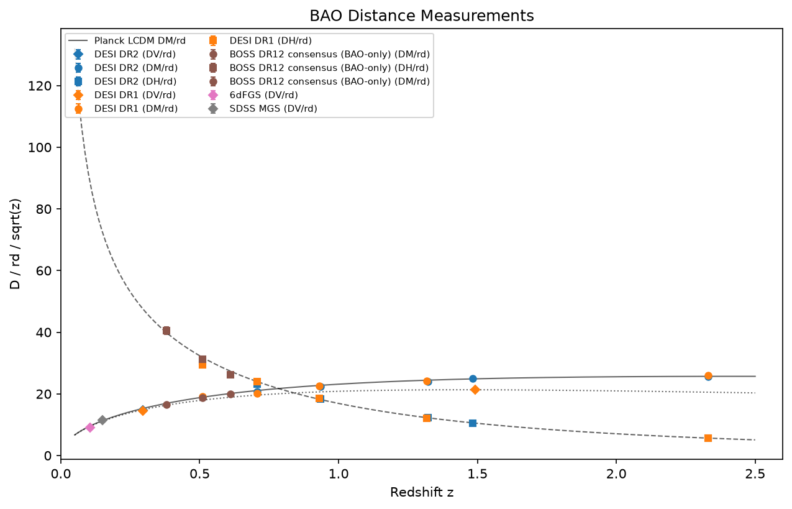
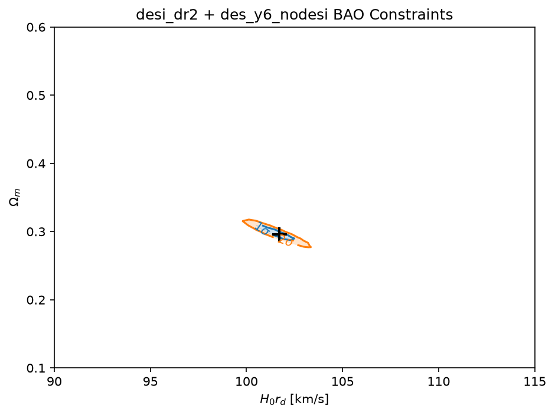
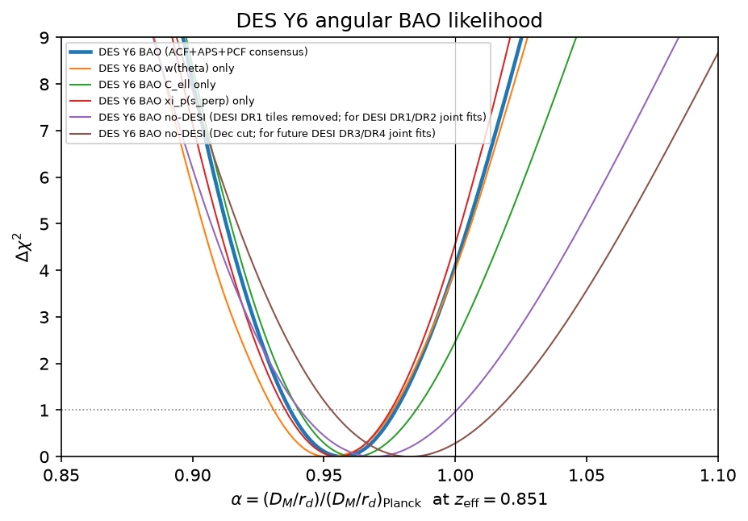
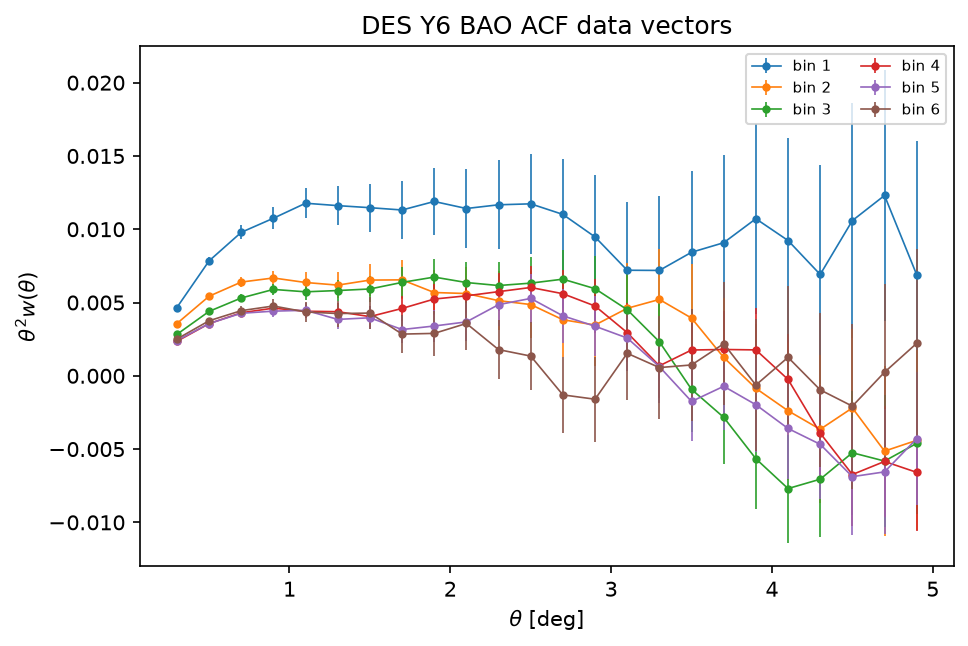
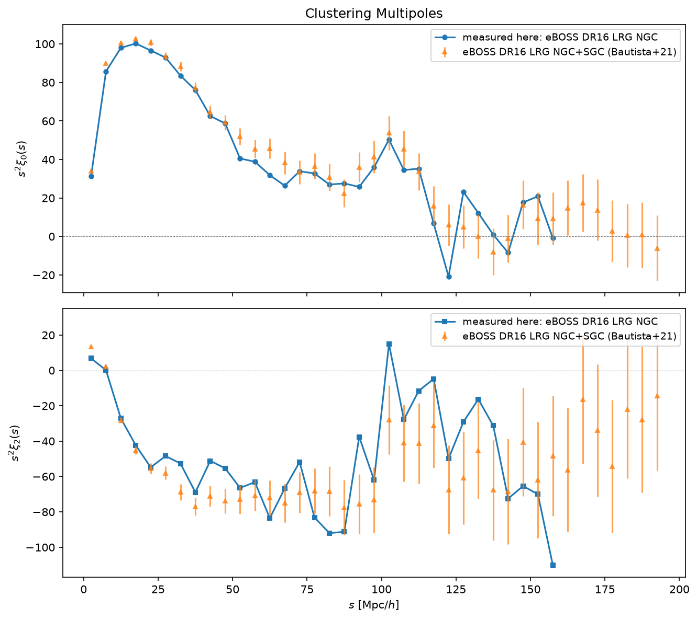
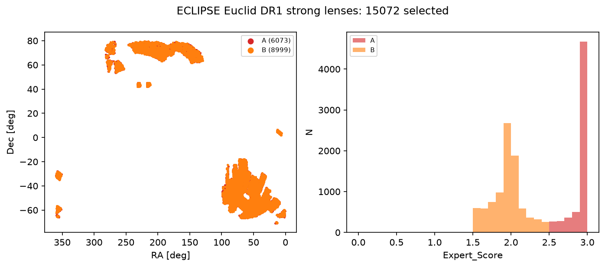
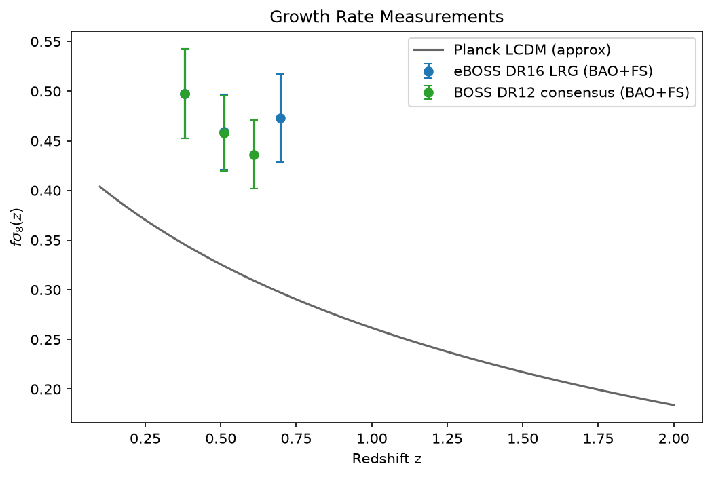
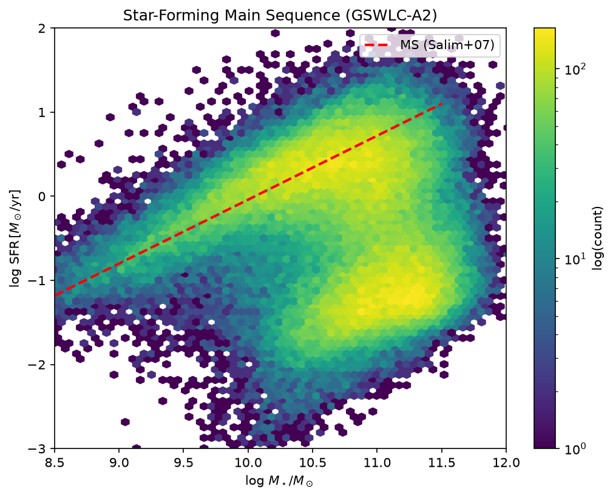
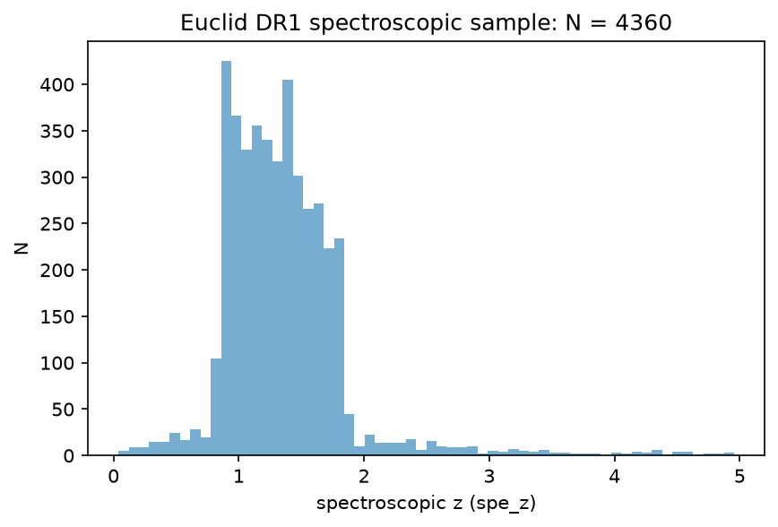
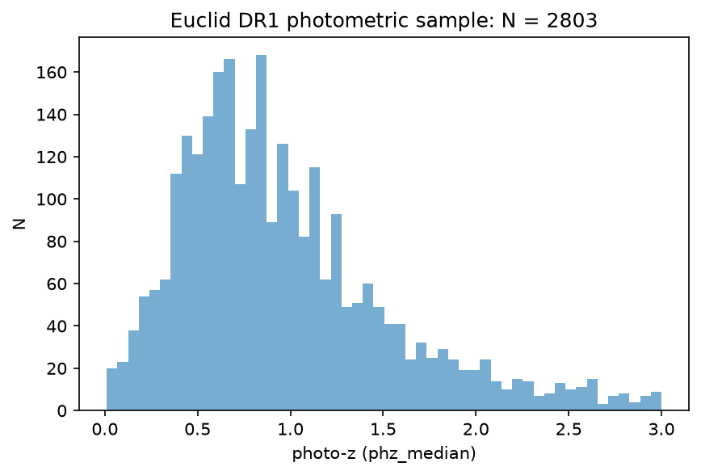

# galaxy-surveys-mcp-server

MCP server for spectroscopic and photometric galaxy surveys: BAO/RSD compilations (DESI DR2/DR1, eBOSS DR16, BOSS DR12, 6dFGS, SDSS MGS, DES Y6), LSS clustering catalogs, SDSS, GSWLC-A2 and Euclid DR1.
An agent can fit ΛCDM or w0waCDM to BAO data, measure ξ₀(s) and ξ₂(s) from clustering catalogs, and compare them with released multipoles.
It can also query SDSS and Euclid galaxy catalogs, study galaxy properties with GSWLC-A2 and select Euclid strong lenses.

Part of the cosmo data MCP server family (sn · galaxy-surveys · cmb-data · weak-lensing · clusters). Default port: 8011.

## At a glance

| | |
|---|---|
| Surveys | DESI DR2 and DR1, eBOSS DR16, BOSS DR12, 6dFGS, SDSS DR7 MGS, DES Y6 BAO, SDSS DR18 (SkyServer), GSWLC-A2, Euclid DR1 (catalogs + ECLIPSE lenses) |
| Tools | 32 (12 catalog, 11 summary statistic, 1 published result, 4 meta, 4 dispatch) |
| Skills | 8 (`skills/`) |
| Bundled data | 0.9 MB (BAO compilations and DES Y6 χ²(α) profiles in `data/bao/`) |
| Network | SDSS and Euclid catalog tools (live queries); first use of GSWLC-A2, ECLIPSE, DES Y6 data vectors, LSS catalogs and published multipoles |

## Data

| Dataset | Kind | Content | Shape and type | Source | Access |
|---|---|---|---|---|---|
| `desi_dr2` DESI DR2 BAO | Summary statistic | D_V/r_d, D_M/r_d, D_H/r_d at 7 effective redshifts | vector (13) + matrix (13×13) | DESI 2025, CobayaSampler/bao_data | Bundled |
| `desi_dr1` DESI DR1 BAO | Summary statistic | D_V/r_d, D_M/r_d, D_H/r_d at 7 effective redshifts | vector (12) + matrix (12×12) | DESI 2024, CobayaSampler/bao_data | Bundled |
| `eboss_dr16` BAO + RSD | Summary statistic | D_M/r_d, D_H/r_d, fσ₈ for LRG (z = 0.38, 0.51, 0.698) and QSO (z = 1.48) | LRG vector (9) + matrix (9×9); QSO (`eboss_dr16_qso`) vector (3) + matrix (3×3) | Alam+21, CobayaSampler/bao_data | Bundled |
| `boss_dr12` consensus BAO + RSD | Summary statistic | D_M, H·r_s, fσ₈ at z = 0.38, 0.51, 0.61 | vector (9) + matrix (9×9); BAO only (`boss_dr12_bao`): vector (6) + matrix (6×6) | Alam+17, CobayaSampler/bao_data | Bundled |
| `sdss_mgs` SDSS DR7 MGS BAO | Summary statistic | D_V/r_d likelihood at z = 0.15 | vector (399 probabilities on an α grid, 0.80–1.20) | Ross+15, CobayaSampler/bao_data | Bundled |
| `sixdf` 6dFGS BAO | Summary statistic | r_s/D_V = 0.336 ± 0.015 at z = 0.106 | scalar | Beutler+11 | Bundled (in code) |
| `des_y6` DES Y6 BAO χ²(α) | Summary statistic | Δχ²(α) profiles: consensus, ACF, APS, PCF, and two no-DESI variants; z_eff = 0.851 | 6 tables × 2 cols (α, Δχ²): 3736, 200, 4001, 200, 1001, 1001 rows | DES 2024, Mena-Fernandez+26 | Bundled (0.46 MB) |
| `des_y6` data vectors | Summary statistic | w(θ) (ACF), C_ℓ (APS), ξ_p(s_⊥) (PCF) in 6 z bins + covariance (Planck data-like or MICE mock-like) | ACF 6 × 24 bins, matrix (144×144); APS 6 × 35 bins, matrix (210×210); PCF 6 × 20 bins (+ Nz1), matrix (204×204) | DES 2024, DES DR server | Download (16 KB + 0.9 MB zip) |
| `eboss_dr16` / `boss_dr12` / `desi_dr1_lss` clustering catalogs | Catalog | Galaxy and random positions, z, weights (8 samples, NGC) | table, user-chosen rows × (RA, DEC, Z, weights) | SDSS SAS DR12/DR16, DESI DR1 v1.5 | Download (HTTP Range, row-limited subset) |
| `desi_dr1_lss` official n(z) | Catalog | Number density per z bin (LRG, ELG, QSO) | table, 70 / 80 / 135 rows × 6 cols | DESI DR1 v1.5 | Download (< 12 KB each) |
| `boss_dr12` P(k) multipoles | Summary statistic | Pre-recon P₀, P₂, P₄ + patchy covariance; tools expose NGC z1 (z_eff = 0.38) and z3 (z_eff = 0.61) | table, 41 k bins × (k, P_ℓ) per multipole + covariance (see registry) | Beutler+17, SDSS SAS | Download (3.2 MB tar.gz) |
| `eboss_dr16` ξ(s) multipoles | Summary statistic | Pre-recon ξ₀, ξ₂, ξ₄ (NGC+SGC) for LRG and QSO + covariance | LRG: table, 39 s bins × 7 cols + matrix (117×117, long format); QSO: table, 28 s bins × 7 cols + matrix (84×84, long format) | Bautista+21, Hou+21, SDSS SVN | Download (< 0.6 MB per file) |
| `sdss_skyserver` SDSS DR18 | Catalog | Spectroscopic and photometric objects (SpecObj, PhotoObj, ...) | table, rows per query (`fetch_sdss_galaxies`: ≤ 100000 rows × 23 cols) | Abdurro'uf+23, SkyServer | Query (SkyServer SQL) |
| `gswlc_a2` GSWLC-A2 | Catalog | Stellar mass, SFR, dust attenuation from UV–IR SED fits | table, 640659 rows × 24 cols | Salim+16, Salim+18 | Download (34 MB gz, 112 MB unpacked) |
| `euclid_dr1` Euclid DR1 Wide | Catalog | MER photometry × photo-z, or MER × NISP spectroscopic z and classes | table, rows per query (≤ 200000; area ≤ 30 deg²) | Euclid DR1 2026, ESA Euclid Science Archive | Query (ADQL via TAP) |
| `euclid_eclipse` ECLIPSE | Catalog | Strong-lens candidates: expert grade A/B/C/X, scores, DESI deflector z | table, 26662 rows × 30 cols | Lines+26, Zenodo 19654904 | Download (3.6 MB zip) |

### Where the data comes from
- Bundled: BAO compilations from CobayaSampler/bao_data and DES Y6 χ²(α) profiles in `data/bao/` (0.9 MB). All BAO fits run offline.
- Download: GSWLC-A2, ECLIPSE, DES Y6 data vectors and covariances, published multipoles and DESI n(z) are fetched once over HTTPS. They are cached in `~/.cache/cosmo-mcp/galaxy-surveys-mcp-server/` (override with `$COSMO_MCP_DATA`).
- LSS clustering catalogs: `fetch_galaxy_lss_catalog` reads only the requested rows via HTTP Range (gzip streams for BOSS DR12). Full catalogs are never stored.
- Query: SDSS rows come from SkyServer DR18 via SQL (astroquery). Euclid rows come from the ESA Euclid Science Archive via ADQL. The archive is queried with astroquery (async job), with a plain HTTP TAP sync fallback.
- `data/bao/` also holds eBOSS DR16 ELG and Lyα likelihood files. No tool reads them yet.
- Pre-fetch by calling each fetch tool once. Without network, only the bundled BAO tools work.

### Clustering catalogs

`fetch_galaxy_lss_catalog` keys. Each catalog has data and randoms.

| Key | Survey | z range | Weight columns |
|---|---|---|---|
| `eboss_dr16_lrg_ngc` | eBOSS DR16 LRG NGC | 0.6–1.0 | WEIGHT_SYSTOT × CP × NOZ × FKP |
| `eboss_dr16_qso_ngc` | eBOSS DR16 QSO NGC | 0.8–2.2 | same |
| `eboss_dr16_elg_ngc` | eBOSS DR16 ELG NGC | 0.6–1.1 | same |
| `boss_dr12_cmass_north` | BOSS DR12 CMASS N | 0.43–0.7 | same |
| `boss_dr12_lowz_north` | BOSS DR12 LOWZ N | 0.15–0.43 | same |
| `desi_dr1_lrg_ngc` | DESI DR1 LRG NGC | 0.4–1.1 | WEIGHT × WEIGHT_FKP |
| `desi_dr1_elg_ngc` | DESI DR1 ELG NGC | 0.8–1.6 | same |
| `desi_dr1_qso_ngc` | DESI DR1 QSO NGC | 0.8–2.1 | same |

## Tools

### Catalog tools

| Tool | What it does | Data used | Output | Weight |
|---|---|---|---|---|
| `sdss_sql_query` | Runs a read-only SQL SELECT on SDSS SkyServer DR18 and caches the result. | SDSS DR18 (Query) | CSV | light |
| `fetch_sdss_galaxies` | Selects spectroscopic galaxies by z range and r magnitude, with optional clean-photometry cuts. | SDSS DR18 (Query) | CSV | light |
| `compute_sdss_absolute_magnitudes` | Corrects extinction and computes absolute magnitudes and colours. | SDSS CSV (user file) | CSV | light |
| `plot_color_magnitude` | Plots the colour–magnitude diagram (red sequence and blue cloud). | SDSS CSV (user file) | PNG | light |
| `plot_sdss_redshift_distribution` | Plots the N(z) histogram of an SDSS sample. | SDSS CSV (user file) | PNG | light |
| `query_gswlc_catalog` | Filters, sorts and selects columns of GSWLC-A2. | GSWLC-A2 (Download) | CSV | light |
| `describe_gswlc_catalog` | Lists GSWLC-A2 columns, units and filter syntax. | none | JSON | light |
| `plot_star_forming_main_sequence` | Plots SFR against M* as a density map. | GSWLC-A2 (Download) or user CSV | PNG | light |
| `crossmatch_sdss_gswlc` | Matches an SDSS table to GSWLC-A2 on ObjID or sky position. | SDSS CSV (user file), GSWLC-A2 (Download) | Matched CSV | light |
| `fetch_galaxy_lss_catalog` | Fetches a row-limited, z-filtered subset of one clustering catalog (data or randoms). | eBOSS DR16 / BOSS DR12 / DESI DR1 (Download, HTTP Range) | CSV | light |
| `fetch_euclid_catalog` | Selects photometric or spectroscopic Wide-Survey galaxies in a cone or box, with quality cuts and a deterministic subsample. | Euclid DR1 (Query, ADQL/TAP) | CSV/parquet, summary JSON with ADQL, n(z) | light |
| `fetch_euclid_strong_lenses` | Filters ECLIPSE lenses by grade, expert and ensemble score, DESI deflector z and cone. | ECLIPSE (Download) | CSV, summary JSON, PNG | light |

### Summary statistic tools

| Tool | What it does | Data used | Output | Weight |
|---|---|---|---|---|
| `fetch_bao_measurements` | Loads one BAO dataset with its covariance. DES Y6 rows give the χ²(α) minimum and Δχ² = 1 half-width. | BAO compilations, DES Y6 χ²(α) (Bundled) | CSV, covariance CSV | light |
| `plot_bao_distances` | Plots D/r_d/√z against z for several surveys with the Planck ΛCDM curve. | BAO compilations (Bundled) | PNG | light |
| `fit_bao_cosmology` | Fits Ωm and H₀r_d (ΛCDM or w0waCDM) on a χ² grid. Optional CMB and SN priors. Joint fits combine Gaussian BAO with the DES Y6 χ²(α) profile. | BAO compilations, DES Y6 χ²(α) (Bundled) | Summary JSON, χ² grid NPZ | heavy |
| `plot_bao_contours` | Draws Ωm–H₀r_d contours from a fit grid. | Grid from `fit_bao_cosmology` | PNG | light |
| `plot_fsigma8` | Plots fσ₈(z) measurements with the Planck ΛCDM curve. | BOSS DR12, eBOSS DR16 (Bundled) | PNG | light |
| `fetch_des_y6_bao_likelihood` | Returns a DES Y6 Δχ²(α) profile (consensus, ACF, APS, PCF or no-DESI) with α and D_M/r_d. | DES Y6 χ²(α) (Bundled) | CSV, JSON, PNG | light |
| `fetch_des_y6_clustering` | Returns DES Y6 w(θ), C_ℓ or ξ_p(s_⊥) in 6 z bins with a chosen covariance. | DES Y6 data vectors (Download) | CSV, covariance CSV, PNG | light |
| `measure_correlation_multipoles` | Measures Landy–Szalay ξ₀(s), ξ₂(s) from data and randoms with FKP and systematic weights. Uses Corrfunc, else scipy cKDTree. | Catalog CSVs from `fetch_galaxy_lss_catalog` | CSV (s, ξ₀, ξ₂) | heavy |
| `compute_nz_histogram` | Computes a weighted n(z) histogram from a catalog. For DESI keys it also fetches the official n(z). | Catalog CSV; DESI n(z) (Download) | CSV (+ official n(z) CSV) | light |
| `fetch_published_multipoles` | Returns released P(k) (Beutler+17) or ξ(s) (eBOSS DR16) multipoles with covariance. | BOSS DR12, eBOSS DR16 (Download) | CSV, covariance CSV | light |
| `plot_clustering_multipoles` | Plots ξ(s) or P(k) multipoles, optionally against a published file. | Multipole CSVs | PNG | light |

### Published result tools

| Tool | What it does | Data used | Output | Weight |
|---|---|---|---|---|
| `compare_bao_surveys` | Plots (data − Planck 2018 ΛCDM)/σ for each BAO point, grouped by survey. For comparison only. | BAO compilations (Bundled); Planck parameters in code | PNG | light |

### Meta and dispatch tools

| Tool | What it does | Data used | Output | Weight |
|---|---|---|---|---|
| `list_galaxy_datasets` | Lists datasets by kind, with access and the tools that read them. | Registry | JSON | light |
| `describe_galaxy_dataset` | Describes one dataset: products, URLs, citation, notes. | Registry | JSON | light |
| `list_galaxy_skills` | Lists the skills (multi-tool recipes). | `skills/` | JSON | light |
| `load_galaxy_skill` | Returns the full instructions of one skill. | `skills/` | Text | light |
| `auth_status` | Reports whether this server is signed in to ALCF/NERSC for HPC dispatch. | none | JSON | light |
| `get_dispatch` | Reports where heavy tools run now (local or an HPC facility). | none | JSON | light |
| `set_dispatch` | Sets where heavy tools run: local, polaris (ALCF) or perlmutter (NERSC). | none | JSON | light |
| `export_dispatch_pack` | Exports this server's compute kernels so a client can run them on HPC. | `tools/` | Files + manifest | light |

## Example figures

Regenerate with `MPLBACKEND=Agg .venv/bin/python scripts/make_readme_figures.py`.

| | |
|---|---|
|  |  |
| BAO distances of DESI DR2/DR1, BOSS DR12, 6dFGS and SDSS MGS vs Planck ΛCDM (`plot_bao_distances`) | DESI DR2 + DES Y6 (no DESI) joint fit, Ωm = 0.297 ± 0.009, H₀r_d = 101.6 ± 0.7 km/s (`fit_bao_cosmology` → `plot_bao_contours`) |
|  |  |
| DES Y6 Δχ²(α) profiles; consensus α = 0.957 ± 0.020 (`fetch_des_y6_bao_likelihood`) | DES Y6 θ²w(θ) in 6 z bins with covariance (`fetch_des_y6_clustering`) |
|  |  |
| eBOSS DR16 LRG ξ₀, ξ₂ measured from catalogs vs Bautista+21 (`measure_correlation_multipoles`) | ECLIPSE grade A+B lenses: sky map and expert scores (`fetch_euclid_strong_lenses`) |
|  |  |
| fσ₈(z) compilation vs Planck ΛCDM (`plot_fsigma8`) | GSWLC-A2 star-forming main sequence (`plot_star_forming_main_sequence`) |
|  |  |
| Euclid DR1 spectroscopic sample: 4360 galaxies in a 0.3° cone, median z = 1.30 (`fetch_euclid_catalog`) | Euclid DR1 photometric sample: 2803 galaxies in a 0.2° × 0.2° box, median z = 0.84 (`fetch_euclid_catalog`) |

## Validation

| Check | This server | Reference |
|---|---|---|
| DESI DR2 BAO-only ΛCDM fit (n_grid 80) | best Ωm = 0.296, H₀r_d = 101.7 km/s; marginalised Ωm = 0.298 ± 0.009; χ²/dof = 10.4/11 | DESI 2025: Ωm = 0.297 ± 0.009, H₀r_d ≈ 101.5 |
| DESI DR2 + DES Y6 (no DESI) fit | marginalised Ωm = 0.297 ± 0.009; χ²/dof = 10.8/12; figure: H₀r_d = 101.6 ± 0.7 km/s | DESI 2025 |
| DES Y6 fiducial (D_M/r_d)_Planck at z = 0.851 | 20.38 (`tests/test_des_y6_bao.py`) | DES release README: 20.38 |
| DES Y6 consensus BAO | α = 0.957 ± 0.020, D_M/r_d(0.851) = 19.51 ± 0.41 (`tests/test_des_y6_bao.py`) | DES 2024: 19.51 ± 0.41 |
| ECLIPSE catalogue size | 26662 rows × 30 cols | Zenodo 19654904: 26 662 systems |
| GSWLC-A2 size | 640659 rows × 24 cols | Salim+18: 640,659 galaxies |
| Euclid DR1 spectroscopic cone (0.3°, spe_z_prob ≥ 0.99, VIS < 24.5) | 4360 galaxies, median z = 1.30 (README figure run) | ~5k expected (tool docstring) |

## Skills

| Skill | Use it to |
|---|---|
| `galaxy-tour` | Run one call per tool family. |
| `reproduce-desi-dr2-bao-om` | Reproduce the DESI DR2 BAO Ωm constraint. |
| `reproduce-des-y6-bao` | Reproduce the DES Y6 BAO result and joint fits with DESI. |
| `bao-dark-energy-hints` | Test w0waCDM with BAO and priors. |
| `clustering-measurement-recipe` | Measure ξ(s) multipoles from catalogs and compare with releases. |
| `sdss-gswlc-main-sequence` | Build the star-forming main sequence from SDSS and GSWLC-A2. |
| `euclid-dr1-recipe` | Query Euclid DR1 catalogs and strong lenses. |
| `hpc-dispatch-handoff` | Run heavy kernels on ALCF Polaris or NERSC Perlmutter. |

## Install and run

```bash
python -m venv .venv && .venv/bin/pip install -e ".[dev]"
.venv/bin/python -m mcp_server                 # stdio
.venv/bin/python -m mcp_server --transport streamable-http --port 8011
MPLBACKEND=Agg .venv/bin/python -m pytest -q    # tests (network tests: -m network)
```

## Limitations

- Euclid DR1-Foundation holds catalogs only. Shear 2-pt functions, clustering measurements and covariances are expected with DR1 Complete (mid-2027).
- `fetch_galaxy_lss_catalog` fetches subsets. ξ(s) from a subset is noisier than the published one.
- DES Y6 overlaps the DESI footprint. Use `des_y6_nodesi` with DESI; `des_y6` with DESI runs but returns a warning.
- DES Y6 catalogs, randoms, mask, n(z), templates and mocks are in the release but have no tool.
- SDSS and Euclid tools need network and depend on remote service availability.

## Citation

- DESI DR2 BAO: DESI Collaboration 2025 (arXiv:2503.14738, arXiv:2503.14739).
- DESI DR1 BAO: DESI Collaboration 2024 (arXiv:2404.03002); DESI DR1 LSS catalogs: arXiv:2306.06308.
- eBOSS DR16: Alam et al. 2021, PRD 103, 083533 (arXiv:2007.08991).
- BOSS DR12: Alam et al. 2017, MNRAS 470, 2617 (arXiv:1607.03155); P(k) multipoles: Beutler et al. 2017.
- SDSS DR7 MGS: Ross et al. 2015, MNRAS 449, 835 (arXiv:1409.3242).
- 6dFGS: Beutler et al. 2011, MNRAS 416, 3017 (arXiv:1106.3366).
- DES Y6 BAO: DES Collaboration 2024 (arXiv:2402.10696); no-DESI: Mena-Fernandez et al. 2026, PRD 113, 123521 (arXiv:2601.14864).
- SDSS DR18: Abdurro'uf et al. 2023, ApJS 267, 44.
- GSWLC: Salim et al. 2016, ApJS 227, 2; Salim, Boquien & Lee 2018, ApJ 859, 11.
- Euclid DR1: Euclid Collaboration 2026. ECLIPSE: Lines et al. 2026 (doi:10.5281/zenodo.19654904).
